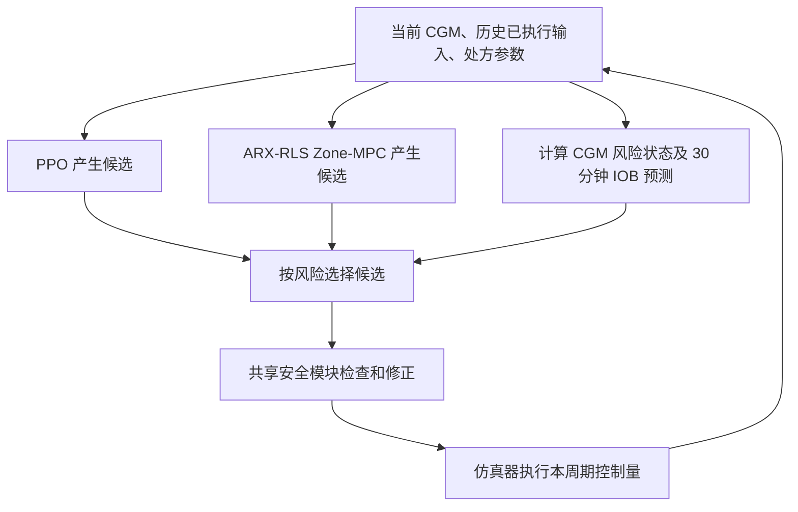

# RL-MPC-a · 风险状态驱动的 PPO–MPC 双向切换

本仓库归档 CAC 2026 论文 **Bidirectional PPO and MPC Switching Policy for Artificial Pancreas Control via Risk-State and Insulin-on-Board Prediction** 的仿真代码、PPO 最终权重和实验结果。每个控制周期，PPO 和 MPC 各自提出一个候选控制量。切换器根据连续葡萄糖监测（CGM）、血糖变化趋势和体内仍起作用的胰岛素（IOB）选择候选，再交给共享安全模块处理。

在 10 名青少年虚拟患者的配对仿真中，切换方法的平均目标范围内时间占比（TIR）由 **75.84% 提高到 77.22%**，配对差值为 **+1.37 个百分点**。高血糖时间占比下降，低血糖时间占比的点估计上升。研究证据限于本仓库记录的 `simglucose` 仿真条件。 [正式结果表](cac-ppo-mpc/results/finall/formal_iob_prediction_adolescent001_010_72h_r5/paper_formal_primary_table.csv)

- **想跑一次** → [快速开始](#快速开始)
- **想读算法** → [切换算法](#切换算法) · [代码索引](#代码索引)
- **想复现论文结果** → [正式实验](#正式实验) · [重新绘图与补充分析](#重新绘图与补充分析)
- **想训练新的模型** → [重新训练 PPO](#重新训练-ppo)

## 快速开始

论文评估在 Linux x86-64、Python **3.10.15** 和归档的精确依赖版本下运行。`--device cpu` 指定 CPU 仿真，依赖锁仍保留原实验使用的 PyTorch CUDA 12.6 发行版本。请先在终端确认 `python --version`，再创建虚拟环境。 [依赖锁](cac-ppo-mpc/requirements-lock-server-py310-cu126.txt)

```bash
git clone https://github.com/1404496757-dby/RL-MPC-a.git
cd RL-MPC-a/cac-ppo-mpc
python -m venv .venv
source .venv/bin/activate
python -m pip install -r requirements-lock-server-py310-cu126.txt
python -m scripts.verify_runtime

# 查看正式评估命令
python reproduce_formal.py --dry-run

# 1 名虚拟患者，两种控制方式，每种各跑 1 小时
python reproduce_formal.py --smoke
```

快速检查的输出写到 `reproductions/smoke/`。查看其中的 `completion.json`，两种方法均完成时会记录 `expected_runs=2`、`completed_runs=2`。复跑时用 `--output-dir` 指定新目录。开发机若使用不同的软件版本，可用 `--smoke --smoke-lock /path/to/local-lock.txt`，并按归档锁的格式记录本机 Python 与依赖的精确版本。正式评估始终使用随仓库发布的正式锁。 [启动脚本](cac-ppo-mpc/reproduce_formal.py) · [运行环境检查](cac-ppo-mpc/scripts/verify_runtime.py)

安装好依赖后，可以运行已有单元测试。

```bash
python -m unittest discover -s tests
```

## 切换算法



### 两个候选怎样得到

- **PPO（近端策略优化）** 直接用已训练的策略网络产生候选输注速率。训练使用 actor–critic 和 `tanh_normal_v2` 有界动作分布。观测包含 CGM、变化率、由已执行输注估计的 IOB 和时刻编码。在正式未预告餐食设置下，餐食和餐时剂量提示不参与决策。 [策略实现](cac-ppo-mpc/ppo_mpc/ppo.py) · [观测与动作映射](cac-ppo-mpc/ppo_mpc/envs.py)
- **MPC（模型预测控制）** 用六阶 ARX 模型预测血糖走势，用递推最小二乘（RLS）在线更新模型，再用 Zone-MPC 求出控制计划。正式设置的预测时域为 120 分钟，控制时域为 45 分钟，分别对应 24 步和 9 步。每个周期只提交计划的首个控制量参与选择。 [MPC 实现](cac-ppo-mpc/mpc_assets/ARX-RLS/arx_mpc_ctrller.py) · [正式配置](cac-ppo-mpc/results/finall/formal_iob_prediction_adolescent001_010_72h_r5/config.json)

### 什么时候选大、什么时候选小

每 **5 分钟**更新一次决策。记当前 CGM 为 $G$、变化率为 $\dot G$，用 $G+h\dot G$ 计算 30、60、90 分钟的趋势外推值。候选有效时，按下表选择。若多个风险条件同时满足，低值或下降分支优先。

| 状态 | 正式配置中的判定 | 候选选择 |
| --- | --- | --- |
| 启动保护、低值或下降风险 | 前 12 步，或 CGM ≤ 90 mg/dL，或下降速率 ≤ −2 mg/dL/min，或 CGM 正在下降且当前值或最低外推值 ≤ 130 mg/dL | 选择总输注速率较小的候选 |
| 高值或上升风险 | 当前 CGM ≥ 160 mg/dL 且变化率 ≥ 0，或最高外推值 ≥ 180 mg/dL 且变化率 > 0 | 30 分钟 IOB 预测 > 130 mg/dL 时允许较大候选，≤ 130 mg/dL 时选较小候选 |
| 常规状态 | 上面两类风险均未触发 | 采用 PPO 的基础输注候选 |

高值分支的预测把趋势外推值减去历史胰岛素可能带来的血糖下降量。

$$
G_{\mathrm{IOB},30} = G + 30\dot G - 0.75\,CF\,\max(0, IOB-IOB_{\mathrm{basal}})
$$

`CF` 是虚拟患者的处方校正因子，`IOB_basal` 是持续按处方基础速率输注时的参考 IOB。`IOB` 由已执行输注历史和各时刻的剩余活性比例计算。高值分支还会先用超出基础水平的 IOB 抵扣估计的校正需求，再调整 MPC 候选的校正下限。这样，选大或选小实际比较的是 PPO 候选与该阶段准备好的 MPC 候选。

选择结果进入共享安全模块，按低值、下降和高值风险约束实际输出。执行后的控制量写回历史，用于下一周期的 IOB 估计与 MPC 更新。代码另有基于 ARX 一步残差的 MPC 准入门控。正式实验采用 `switch_nogate_shield`，该门控关闭，共享安全模块和候选有效性检查启用。 [切换器与公共控制包装](cac-ppo-mpc/ppo_mpc/controllers.py) · [安全约束](cac-ppo-mpc/ppo_mpc/safety.py) · [可选残差门控](cac-ppo-mpc/ppo_mpc/compatibility.py)

## 正式实验

| 项目 | 记录 |
| --- | --- |
| 平台 | 随项目发布的 `simglucose`，餐食不预告，控制周期 5 分钟 |
| PPO 训练及 ARX 初始先验 | 成人虚拟患者 `adult#001`–`adult#005`，PPO 训练 200 万步 |
| 评估对象 | 青少年虚拟患者 `adolescent#001`–`adolescent#010` |
| 对照方法 | `ppo_shield`（PPO 加共享安全模块）与 `switch_nogate_shield`（风险双向切换加共享安全模块） |
| 配对方式 | 同一虚拟患者、同一重复编号，两种方法使用相同的随机场景。每名患者 5 对，每次计划 72 小时，共 100 次运行 |
| 评价口径 | 控制使用 CGM 等当时可获得的信息。论文主指标使用仿真器内部血糖 BG。低于 10 mg/dL 或高于 600 mg/dL 可触发仿真终止 |

青少年对象与 PPO 训练、ARX 先验拟合所用成人对象分开。项目的历史开发记录中，这批青少年对象也用于早期筛查，因此这里将结果表述为这组虚拟患者上的配对比较，外部队列的泛化仍需验证。正式配对数据包含上述两种方法，比较对象是带相同安全模块的 PPO。

### 复跑和查看输出

在 `cac-ppo-mpc/` 内，用归档权重和正式配置启动全部运行。

```bash
python reproduce_formal.py
```

默认输出到 `reproductions/formal/`。启动脚本会校验评价源码、PPO 权重、ARX 初始参数及依赖锁的 SHA-256。实际实验配置以归档的 `config.json` 为准，代码中的默认阈值也服务于其他实验模式。 `results/finall/` 是仓库沿用的目录名。 [正式配置](cac-ppo-mpc/results/finall/formal_iob_prediction_adolescent001_010_72h_r5/config.json) · [正式权重](cac-ppo-mpc/runs/ppo_adult001_005_unann_tanh_v2_2m/model_final.pt)

| 文件 | 读法 |
| --- | --- |
| `config.json` | 记录对象、场景、重复、阈值、权重及环境指纹 |
| `completion.json` | 区分任务执行完毕和单次运行达到完整时域，配合 `summary.csv` 查看提前终止 |
| `summary.csv` | 一行对应一次运行，含 BG 和 CGM 指标及终止信息 |
| `aggregate_by_patient_mode.csv` | 按虚拟患者和方法汇总 |
| `*_rollout.csv` | 复跑生成的逐步仿真轨迹，包含 BG、CGM 和输注等记录 |
| `*_policy_history.csv` | 复跑生成的决策日志，含候选、选择原因及安全模块修正，可用来区分候选值与执行值 |

### 论文主结果

下表使用 BG。TIR 是 70–180 mg/dL 范围内时间占比，TBR 和 TAR 分别是低于或高于指定阈值的时间占比。每名患者先在方法内平均其 5 次重复，再做患者级配对比较（n = 10）。差值为“切换 − PPO”，95% CI 来自 20,000 次患者级 bootstrap，配对检验使用双侧 Wilcoxon 检验，`q` 是对五项主指标做 BH-FDR 校正后的值。 [逐次结果](cac-ppo-mpc/results/finall/formal_iob_prediction_adolescent001_010_72h_r5/summary.csv) · [患者级差值](cac-ppo-mpc/results/finall/formal_iob_prediction_adolescent001_010_72h_r5/paper_formal_patient_differences.csv)

| 指标 | PPO | 双向切换 | 配对差值（百分点） | 95% CI（百分点） | q |
| --- | ---: | ---: | ---: | ---: | ---: |
| TIR 70–180 | 75.84% | 77.22% | +1.37 | [0.74, 2.15] | 0.0098 |
| TBR < 70 | 0.41% | 0.70% | +0.28 | [0.04, 0.57] | 0.0787 |
| TBR < 54 | 0.08% | 0.15% | +0.07 | [0.00, 0.16] | 0.1088 |
| TAR > 180 | 23.74% | 22.09% | −1.66 | [−2.39, −0.97] | 0.0098 |
| TAR > 250 | 11.10% | 9.91% | −1.19 | [−1.72, −0.66] | 0.0181 |

补充指标中，平均 BG 由 159.99 降至 156.30 mg/dL，配对差值为 −3.69 mg/dL。轨迹中的累计输注量由 84.88 增至 88.78 U，配对差值为 +3.90 U。 [全部指标](cac-ppo-mpc/results/finall/formal_iob_prediction_adolescent001_010_72h_r5/paper_formal_primary_table.csv)

- **提前终止与完整配对。** 100 次任务都完成处理，其中 PPO 提前终止 6/50 次，切换提前终止 5/50 次。主分析保留终止前的观测，终止后时段不做填补。两种方法都达到 72 小时的 44 对结果中，TIR 的配对差值为 +1.57 个百分点。 [终止汇总](cac-ppo-mpc/results/finall/formal_iob_prediction_adolescent001_010_72h_r5/paper_formal_early_termination.csv) · [完整配对结果](cac-ppo-mpc/results/finall/formal_iob_prediction_adolescent001_010_72h_r5/paper_formal_complete_pair_table.csv)
- **阈值敏感性。** 以当前配置为中心一次只变动一组阈值，共 9 套切换配置。每套按同一组 10 名患者、每人 3 次重复与共享 PPO 参考配对。BG-TIR 差值范围为 +1.18 至 +1.53 个百分点，两个 TAR 指标在所测范围内都下降。 [阈值敏感性汇总](cac-ppo-mpc/results/finall/reviewer2_threshold_sensitivity_72h_r3/paper_threshold_sensitivity_compact_table.csv)
- **低血糖与闭环行为。** 主分析两项 BG-TBR 的点估计上升，校正后的 `q` 均大于 0.05。按 CGM 另做的补充分析观察到低值暴露上升。有限时域的轨迹诊断用于描述此协议下的输入变化和低值暴露，证据范围限于仿真。 [补充分析报告](cac-ppo-mpc/results/finall/reviewer2_safety_stability_formal_72h_r5/RESULTS.md)

## 重新绘图与补充分析

在 `cac-ppo-mpc/` 内运行下面两条命令，可直接用随仓库发布的汇总表重绘正式配对结果和阈值敏感性图。脚本将图和重算表写回各自所在目录。

```bash
python results/finall/formal_iob_prediction_adolescent001_010_72h_r5/plot_paper_results.py
python results/finall/reviewer2_threshold_sensitivity_72h_r3/plot_paper_threshold_sensitivity.py
```

要复算闭环安全与输入变化统计，先完成正式复跑，再将新产生的逐步轨迹和决策日志交给分析脚本。

```bash
python results/finall/tools/analyze_safety_stability.py \
  --input-dir reproductions/formal \
  --output-dir reproductions/safety
```

## 重新训练 PPO

正式结果使用已归档的 `model_final.pt`。下面的命令用当前训练入口和归档超参数训练一个新权重，输出到 `runs/ppo_retrain/`。

```bash
python -m scripts.train_ppo \
  --patients 'adult#001,adult#002,adult#003,adult#004,adult#005' \
  --scenario train --meal-announcement unannounced --sensor-name GuardianRT \
  --steps 288 --seed 61000 --total-steps 2000000 --steps-per-update 2048 \
  --hidden-dim 128 --minibatch-size 256 --update-epochs 10 \
  --policy-lr 0.0003 --value-lr 0.001 --entropy-coef 0.01 \
  --max-basal-multiplier 5.0 --save-every-updates 10 --device cpu \
  --output-dir runs/ppo_retrain
```

新训练目录会写入 `config.json`、`training_log.csv`、周期检查点和 `model_final.pt`。论文权重的原始训练源码指纹与这里的评估快照指纹不同，重训旨在复用训练协议。复跑论文指标时，使用归档权重可固定策略参数。 [归档训练配置](cac-ppo-mpc/runs/ppo_adult001_005_unann_tanh_v2_2m/config.json) · [训练日志](cac-ppo-mpc/runs/ppo_adult001_005_unann_tanh_v2_2m/training_log.csv) · [训练入口](cac-ppo-mpc/scripts/train_ppo.py)

## 代码索引

| 路径 | 用途 |
| --- | --- |
| [`cac-ppo-mpc/reproduce_formal.py`](cac-ppo-mpc/reproduce_formal.py) | 从归档配置启动快速仿真和论文评估 |
| [`cac-ppo-mpc/ppo_mpc/`](cac-ppo-mpc/ppo_mpc/) | PPO、观测状态、切换器、IOB、共享安全模块、指标与环境校验 |
| [`cac-ppo-mpc/mpc_assets/`](cac-ppo-mpc/mpc_assets/) | ARX-RLS Zone-MPC、初始参数和 `simglucose` 仿真所需文件 |
| [`cac-ppo-mpc/scripts/`](cac-ppo-mpc/scripts/) | 训练、批量闭环评估、参数工具和实验分析入口 |
| [`cac-ppo-mpc/runs/`](cac-ppo-mpc/runs/) | 论文使用的最终冻结权重、训练配置和日志 |
| [`cac-ppo-mpc/results/finall/`](cac-ppo-mpc/results/finall/) | 正式结果、补充统计和重绘程序 |
| [`cac-ppo-mpc/tests/`](cac-ppo-mpc/tests/) | PPO 动作分布、门控、实验协议及结果分析的单元测试 |

## 论文信息与第三方代码

Buyun Deng, Xia Yu, Xiaoyu Sun, and Hongru Li. *Bidirectional PPO and MPC Switching Policy for Artificial Pancreas Control via Risk-State and Insulin-on-Board Prediction*. CAC 2026 会议论文终稿。

仓库带有适配本实验的 `simglucose` 副本。 [上游项目](https://github.com/jxx123/simglucose) · [随附的 MIT 许可证](cac-ppo-mpc/mpc_assets/simglucose/LICENSE)
